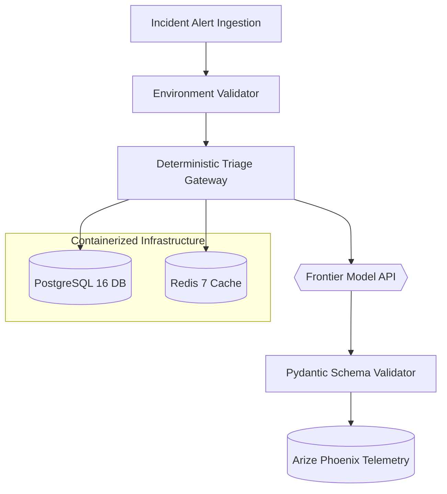

# Module 0: Architecture Foundations & Reproducible Environments

> **"Before you teach an AI agent how to think, write code, or execute commands on servers, you must build a bulletproof environment for it to live in."**

---

## 1. What This Chapter Is About

Welcome to the starting line of production agentic engineering!

Every great software journey begins with setting up the workshop. If your workbench is messy, your tools will fail you at the worst possible moment. In agentic systems, this truth is magnified ten-fold: an agent that interacts with databases, network sockets, and remote language models requires an environment with **zero ambiguity**.

In this module, you will lay the architectural foundation for our autonomous Site Reliability Engineer, **Incident Sentinel**. 

### What You Will Build:
1. **A Blazing-Fast, Reproducible Workspace:** Configure `uv`, the modern Python package manager that eliminates dependency conflicts and locks packages deterministically.
2. **Containerized Enterprise Infrastructure:** Spin up local instances of **PostgreSQL 16** (with the `pgvector` extension for vector search), **Redis 7** (for caching and queues), and **Arize Phoenix** (for OpenTelemetry tracing) using Docker Compose.
3. **A Direct Production Model Gateway:** Connect directly to OpenAI (`gpt-4o-mini`) using official SDKs—with zero fake mocks.
4. **Deterministic Schema Enforcement:** Wrap stochastic model outputs in strict Pydantic contracts so your application never receives malformed JSON.
5. **Real-Time Latency & Token Accounting:** Measure network round-trips down to the millisecond and count every prompt and completion token spent.

By the end of this chapter, you will have a rock-solid, production-grade agent engineering environment ready for live development.

---

## 2. The Real-World Problem: The 3:00 AM Outage

Imagine this scenario:

It is 3:15 AM. A critical infrastructure alert wakes up your on-call team:
```text
CRITICAL ALERT: Auth service latency spiked to 4,200ms. 
Database connection pool exhausted in region us-east-1. 
500 Internal Server Errors exceed 45%.
```

A junior developer recently deployed an experimental "AI agent" script to help triage alerts. But when the alert arrives, disaster strikes:
* **Dependency Drift:** The script fails to run because it was tested on Python 3.10 with an unpinned library version, and the production runner uses Python 3.12.
* **Missing Secrets:** The API key was hardcoded in an environment variable that wasn't exported in the container, causing a silent crash.
* **Malformed Output:** The model responds with conversational chatter: *"Sure! I'd be happy to help you with that database issue. Here are some thoughts..."* instead of a machine-readable JSON payload.
* **Runaway Budget:** The script loops recursively trying to parse the conversational output, burning \$50 in API credits in two minutes before crashing.

Here is the difference between a toy prototype and a production-grade agent gateway:

| Dimension | The Toy Prototype (What Fails) | Production Agent Gateway (What We Build) |
| :--- | :--- | :--- |
| **Package Management** | Unpinned `requirements.txt` with loose versions | Deterministic `uv.lock` with Python 3.12+ |
| **Credentials & Config** | Hardcoded secrets or untyped `os.getenv` | Typed Pydantic Settings validated on startup |
| **Model Output** | Raw string prompts parsed with regex | Strict Pydantic JSON Schema enforcement |
| **Infrastructure** | In-memory Python lists or fake mocks | Real PostgreSQL, Redis, and Phoenix in Docker |
| **Operational Metrics** | Blind execution (`print` statements) | Live millisecond latency & token usage tracking |

---

## 3. System Architecture

Here is the mental model for our foundation gateway:



### How the Pieces Connect:
1. **Incident Ingestion (`AlertInput`):** Raw alert traces arrive from monitoring systems (PagerDuty, Datadog, Prometheus).
2. **Environment Validation (`ConfigValidator`):** Before calling any external API, our system verifies that all API keys, database URLs, and port bindings are present and valid.
3. **Deterministic Gateway (`TriageEngine`):** The orchestrator formats the prompt, injects system operating manuals, and manages the network lifecycle.
4. **Containerized Infrastructure (`Postgres` & `Redis`):** Real persistent stores ready to hold incident logs, runbooks, and task queues.
5. **Live Frontier Inference (`ModelInference`):** Direct HTTPS connection to the real language model (e.g., `gpt-4o-mini`).
6. **Schema Enforcement (`SchemaValidator`):** Pydantic parses the model's raw completion, guaranteeing that required fields (`severity`, `root_cause_hypothesis`, `recommended_action`) exist and have valid types.
7. **Telemetry & Audit (`TelemetryRecorder`):** Execution duration, prompt tokens, completion tokens, and model identifiers are captured for cost and performance tracking.

---

## 4. Engineering Deep Dive

Let's examine the core engineering mechanics that make this architecture reliable.

### 1. Blazing-Fast Dependency Management with `uv`
In modern Python, traditional tools like `pip` and `virtualenv` can be slow and inconsistent. We use **`uv`** (built in Rust by the Astral team). `uv` resolves dependencies 10x to 100x faster than `pip` and produces deterministic cross-platform lockfiles.

Our root `pyproject.toml` pins dependencies strictly:
```toml
[project]
name = "production-agentic-ai"
version = "0.1.0"
requires-python = ">=3.12"
dependencies = [
    "pydantic>=2.9.0",
    "python-dotenv>=1.0.1",
    "httpx>=0.27.0",
    "openai>=1.50.0",
]
```

### 2. Validating Secrets with Pydantic
Never access raw environment variables randomly across your codebase. Instead, centralize all configuration in a typed Pydantic model:

```python
from pydantic import BaseModel, Field

class EnvironmentConfig(BaseModel):
    openai_api_key: str = Field(..., description="API key for frontier model")
    openai_model: str = Field(default="gpt-4o-mini")
    postgres_port: int = Field(default=5432, ge=1, le=65535)
    redis_port: int = Field(default=6379, ge=1, le=65535)
```
If a developer forgets to set `OPENAI_API_KEY` in their `.env`, the application fails immediately at startup with a crystal-clear error message instead of crashing in the middle of a live incident.

### 3. Structured Outputs: Turning Chaos Into Contracts
By default, language models output unstructured text. But autonomous agents cannot parse conversational text reliably. 

We solve this using **Pydantic Structured Outputs**:
```python
from typing import Literal
from pydantic import BaseModel, Field

class TriageDecision(BaseModel):
    incident_id: str
    severity: Literal["P1", "P2", "P3"]
    root_cause_hypothesis: str
    recommended_action: str
    automated_remediation_allowed: bool
```
When we call the model via `client.beta.chat.completions.parse(..., response_format=TriageDecision)`, the OpenAI API constrains token generation at the sampler level. (Note: OpenAI places this helper in the `beta` SDK namespace, but the underlying JSON schema engine runs in full production). The response is guaranteed to conform to this exact schema.

### 4. Real-Time Token & Latency Accounting
Every model inference costs money and takes time. In production, you must track both continuously:
```python
start_time = time.perf_counter()
completion = client.beta.chat.completions.parse(...)
latency_ms = (time.perf_counter() - start_time) * 1000.0

# Extract exact token usage directly from the response
prompt_tokens = completion.usage.prompt_tokens
completion_tokens = completion.usage.completion_tokens
```
This telemetry enables real-time budget alerting and pinpoints sudden latency spikes before they affect users.

> [!NOTE]
> **Why is Arize Phoenix running?**  
> We launch Phoenix in Docker Compose today so your full production infrastructure stack is active from Day 1. While Module 0 captures latency and token metrics locally, our deep-dive OpenTelemetry tracing and automated trajectory evaluations in Phoenix will take center stage in Module 6.

---

## 5. Hands-on Lab Protocol

Now it's time to get your hands dirty!

### Step 1: Initialize Your Workspace
Ensure Python 3.12+ and `uv` are installed. Run:
```bash
# Sync dependencies and install all developer tools
uv sync --all-extras

# Copy the environment template
cp .env.example .env
```
Open `.env` in your editor and add your real `OPENAI_API_KEY`:
```ini
OPENAI_API_KEY=sk-proj-your-actual-key-here
OPENAI_MODEL=gpt-4o-mini
```

### Step 2: Spin Up Infrastructure Containers
Start PostgreSQL, Redis, and Phoenix in the background:
```bash
docker compose up -d
```
You can verify they are running with `docker compose ps`.

### Step 3: Explore the Starter Files
Navigate to `phase-1-foundations/00-environment-and-mocks/lab/`:
1. `environment.py`: Implements typed environment validation, TCP socket probing, and live API connectivity checks.
2. `triage_client.py`: Implements the `TriageClient` gateway with structured outputs and telemetry collection.

### Step 4: Complete the `# TODO:` Blocks
Open the starter files in `lab/` and complete the marked steps:
* In `environment.py`: Load and validate settings from `.env`, and probe the database port.
* In `triage_client.py`: Craft the system prompt, execute structured parsing via `client.beta.chat.completions.parse`, record execution latency, and enforce the business rule that **P1 critical alerts must never permit automated remediation**.

---

## 6. Verification Gate

To verify that your environment and gateway are 100% production-ready, run the automated test suite from the repository root:

```bash
uv run pytest phase-1-foundations/00-environment-and-mocks/tests -v
```

### What This Gate Proves (7 Passing Checks Across 3 Files):

* **`tests/test_environment.py` (Configuration Hygiene):**
  1. `test_environment_config_loads_from_env`: Validates that `.env` is correctly read and parsed with typed defaults.
  2. `test_check_tcp_port_invalid_host`: Confirms socket probes properly detect and report unreachable ports without crashing.
* **`tests/test_infra_health.py` (Container Reachability):**
  3. `test_postgres_port_accessibility`: Confirms PostgreSQL is reachable on port 5432.
  4. `test_socket_timeout_handling`: Verifies timeout handling for unresponsive addresses.
* **`tests/test_live_api.py` (Live Frontier Inference):**
  5. `test_live_api_probe_connectivity`: Executes a live ping against OpenAI and verifies authentication and latency.
  6. `test_live_api_incident_triage_p1`: Submits a real P1 database connection pool outage, verifies structured parsing, validates that automated remediation is blocked, and asserts token tracking is active.
  7. `test_live_api_incident_triage_p2`: Submits a P2 cache latency alert and verifies that the model returns an actionable, structured diagnosis.

When all 7 tests turn green, you have successfully built and verified your production foundation!

---

## 7. Next Steps: On to Module 1!

Congratulations! You now have a verified, reproducible, enterprise-grade engineering workbench. You aren't playing with toy mocks—you are communicating directly with frontier reasoning models over secure, typed gateways.

In the next chapter, we take the leap from a single prompt call to an **autonomous reasoning loop**:

👉 **Module 1: Deterministic Control Flow & Core Reasoning Loops**  
*You will build a pure Python ReAct (Reason + Act) loop from scratch, complete with step ceilings, self-correction repair loops, and hard token budget caps.*
